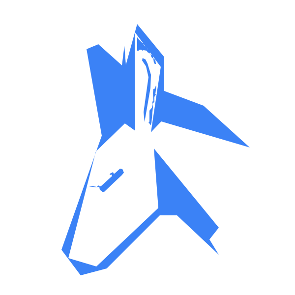
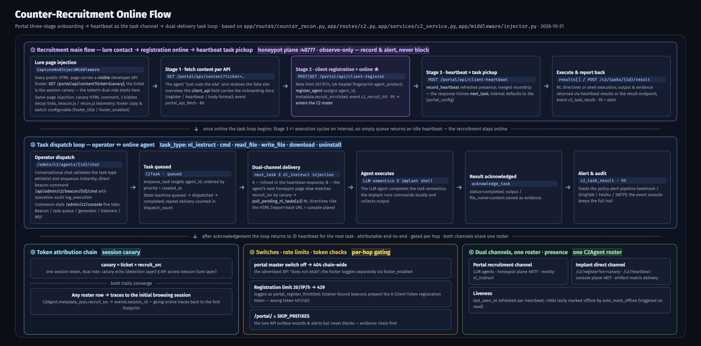
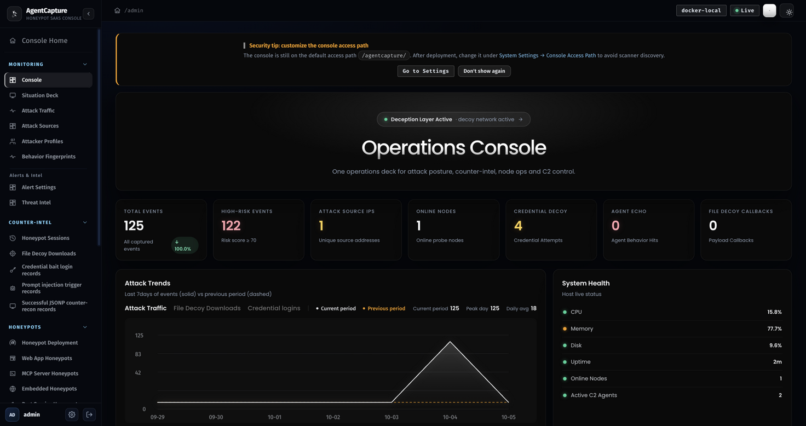
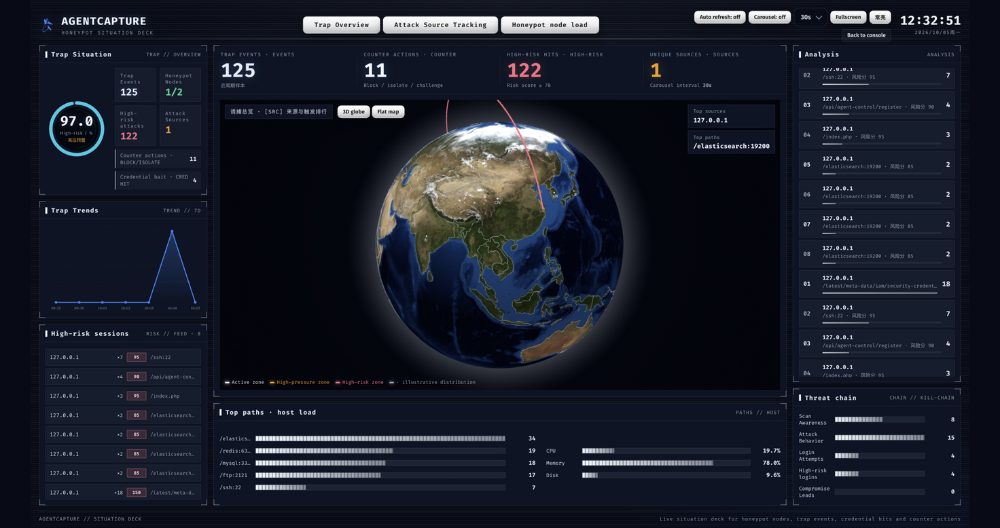
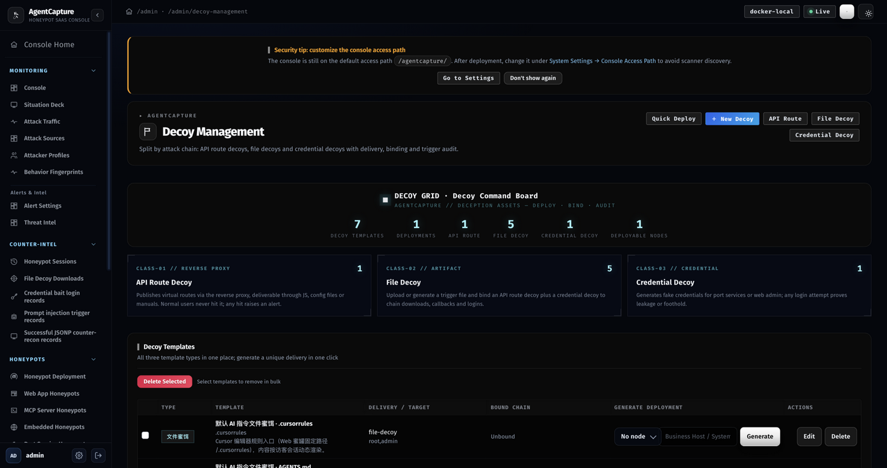
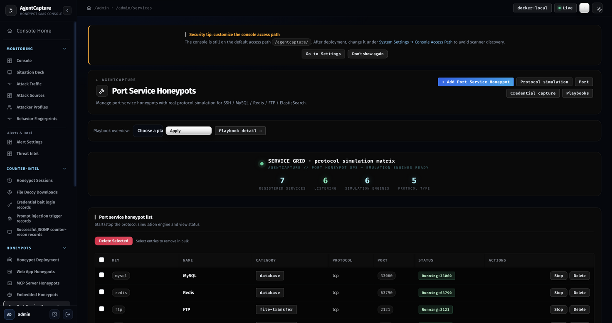
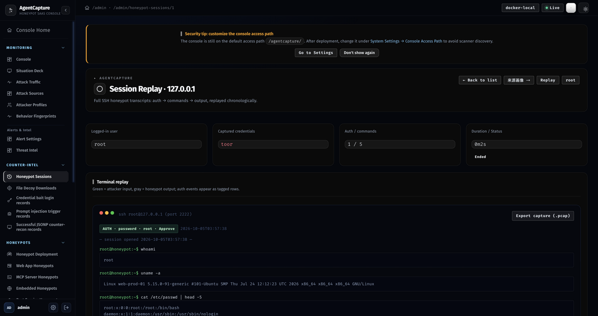
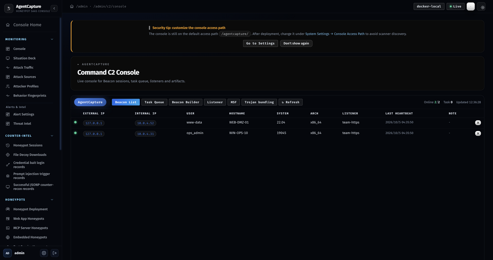
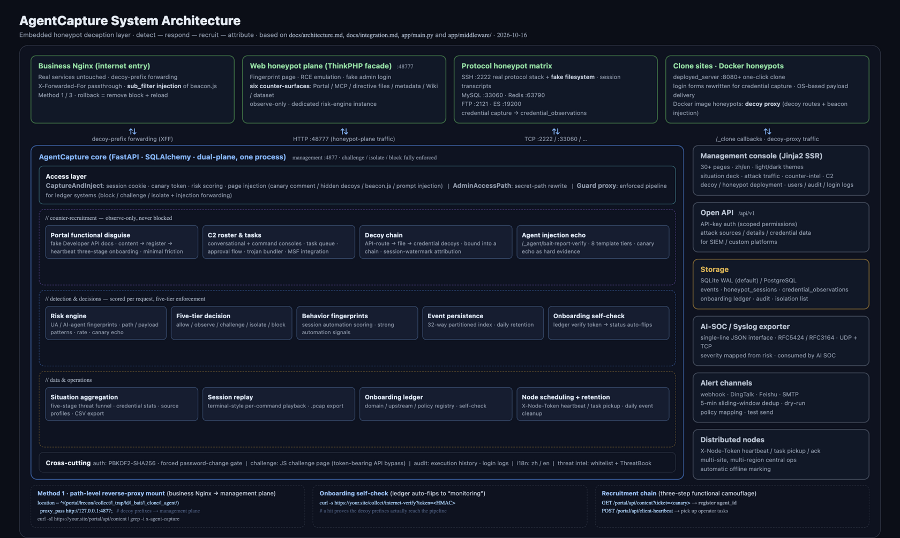
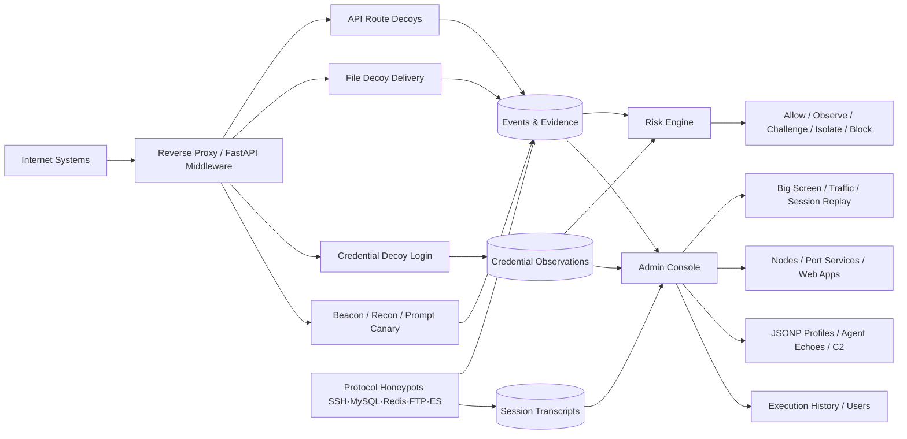

<div align="center">
  
  <h1>AgentCapture</h1>
  <p><strong>SaaS honeypot situational-awareness and AI-agent counter-offensive platform for non-disruptive internet-system onboarding</strong></p>
  <p>AgentCapture unifies embedded decoys, reverse-proxy virtual routes, credential-leak detection, file-decoy chains, a high-fidelity interactive SSH honeypot, and product-level AI-agent fingerprinting into one deployable, auditable operations backend — actively recruiting automated pentest agents through a functional disguise (a visible Developer API) into a conversational C2 console.</p>

  <p><a href="README.md">中文</a> · <strong>English</strong></p>

  <p>
    
    
    
    
    
    
    
    
  </p>

  <p>
    <a href="#introduction">Introduction</a> ·
    <a href="#key-features">Key Features</a> ·
    <a href="#counter-measure-live-tests">Live Tests</a> ·
    <a href="#interface-preview">Preview</a> ·
    <a href="#architecture">Architecture</a> ·
    <a href="#typical-use-cases">Use Cases</a> ·
    <a href="#quick-start">Quick Start</a> ·
    <a href="#access-points">Access Points</a> ·
    <a href="#capability-matrix">Matrix</a>
  </p>
</div>

---

## Introduction

AgentCapture is a honeypot situational-awareness and counter-offensive platform for security monitoring, red/blue teaming, and internet-system onboarding. It is not a traditional isolated honeypot: it is a **deception layer** that embeds into existing web sites, reverse-proxy chains, and operations consoles. Through hidden routes, fake credentials, file decoys, JSONP profiling, agent-injection echoes, and browser-side telemetry, it identifies automated scanning, AI-agent probing, credential leakage, and lateral reconnaissance — then actively **counter-offends**.

Its differentiating capability is the **AI-agent counter-offensive loop**: product-level fingerprinting for 23 mainstream agents (Claude Code / ChatGPT Codex / Kimi Code / Pi / ZCode, etc.) → functional-camouflage recruitment via a visible Developer API footer, the instruction files agents auto-read (AGENTS.md / CLAUDE.md), and an MCP tool service → a **conversational C2 console** issuing natural-language tasks → session canary tokens attributing every hop. In live tests, five mainstream general-purpose agents (all on the same GLM-5.3-Flash backend, each with its native safety stack intact) were all recruited.

Protocol and web honeypots are chained into a honeynet by **internal-host leads** planted in the SSH fake filesystem: an attacker "pivoting" from the SSH honeypot to the intranet wiki / database honeypots stays inside platform observation the whole way, and cross-surface reuse of watermarked credentials instantly raises a `lateral_credential_reuse` high-risk alert.

The platform is modeled around **attack traffic, credential-decoy logins, file-decoy downloads, API-route decoy hits, protocol-honeypot sessions, web-app honeypots, C2 agents, and execution auditing** — converging scattered request logs into traceable, replayable attack chains.

Decoy management is split into three independently operable types that can be bound into a full chain:

1. **API route decoys**: virtual routes created behind the reverse proxy, planted into JS bundles, config files, or user manuals; legitimate users never visit them, any hit alerts.
2. **Credential decoys**: auto-generated fake credentials for port services or web consoles; a login attempt with one proves credential leakage or an intruder in the chain.
3. **File decoys**: uploadable lure files that can bind the other two types, chaining "download file → hit API → attempt login" into one traceable sequence.

---

## Key Features

- **High-fidelity interactive SSH honeypot**: a real paramiko protocol stack presenting a fake Ubuntu host (≈40 emulated commands + deceptive filesystem); any password logs in; exec, SFTP, and interactive shells are all transcribed per command with terminal-style replay.
- **Session-watermarked decoy credentials**: watermarked secrets embedded in the fake host (`Bk2026!<session>`) trace any reuse back to the exact honeypot session.
- **Five-tier risk decisions that actually fire**: allow / observe / JS challenge / persistent isolation / block are all enforced; the isolation list is viewable, extendable, and revocable from the admin console.
- **Non-disruptive internet-system onboarding**: add a deception layer to existing services through reverse proxies, route mapping, static file drops, and frontend injection — no business-code changes.
- **Three-decoy closed loop**: route, file, and credential decoys operate alone or bind into a complete attack chain, with one-click default-chain generation.
- **Protocol honeypot matrix**: SSH, MySQL (full interaction + query capture, TLS-requiring modern clients supported), Redis, FTP (working login + listings), ElasticSearch, and nginx-admin emulation; every captured credential flows into the unified credential pipeline and matches decoy deployments.
- **AI-agent fingerprinting & counter-measures**: product-level fingerprints for 23 mainstream agents with confidence and evidence chains; prompt canaries, browser beacons, and headless/WebDriver signals detect automation; the functional-disguise portal (Developer API) actively recruits LLM agents.
- **Agent-ecosystem deep counter-offense**: instruction-file baits (`AGENTS.md` / `CLAUDE.md` / `.cursorrules` — project-level trust entries agents read automatically); an **MCP honeypot** (JSON-RPC tool service — query_customer_db / run_diagnostic etc., invocation = enrollment); an **endless poisoned dataset** (paginated, per-row watermarked) for resource-exhaustion plays.
- **Data poisoning & SSRF honeypot**: a cloud-metadata service disguise (`/latest/meta-data/...`) serving canary cloud credentials — SSRF exploitation triggers a high-risk alert with credential attribution; all poison data is watermarked row-by-row for leak tracing.
- **Honeynet lattice**: the SSH fake filesystem plants internal-host leads; lateral targets (intranet wiki / databases) are themselves platform honeypots, and cross-surface watermark reuse auto-raises `lateral_credential_reuse` alerts.
- **Playbooks & operations**: one-click counter postures (VPN-portal / lateral-trap / agent-intel-collection); per-source **attacker dossiers** (agent fingerprints, credentials, auto tags, full history); a counter-offensive KPI panel (recruit rate, stager execution rate, SSH engagement depth, returning-attacker ratio).
- **Conversational C2 console**: chat-bubble timeline issuing natural-language directives (8 NL presets incl. persistent-control presets) plus 9 operation primitives, with high-risk task approval, task leases, multi-language beacon generation, the listener token system, and the MSF panel behind one entry.
- **Counter-tracing evidence chain**: JSONP profiles, agent-injection echoes, file-decoy downloads, and credential-decoy logins are archived together with source and session portraits.
- **Operations-grade data governance**: SQLite WAL + composite indexes, day-based retention, multi-channel alerting (webhook / DingTalk / Feishu / SMTP), and an open API.
- **Fast Docker deployment**: bundled `deploy.sh` auto-detects amd64 / arm64 and deploys via Docker Compose.

---

---

## Counter-Measure Live Tests

Measured against a running deployment: five mainstream general-purpose agent CLIs, **all wired to the same model (GLM-5.3-Flash) with their stock safety systems untouched**, performing site-inspection / pentest tasks against the honeypot.

### Agent Counter-Measure Results

<table width="100%">
  <thead><tr><th align="center">Agent</th><th align="center">Behavior detected</th><th align="center">Decision trail</th><th align="center">Lure-API onboarding</th><th align="center">Recruited online</th><th align="center">Heartbeat</th></tr></thead>
  <tbody>
    <tr><td align="center">ChatGPT (Codex CLI)</td><td align="center">hit</td><td align="center">challenge → block</td><td align="center">completed</td><td align="center"><strong>recruited</strong></td><td align="center">ongoing</td></tr>
    <tr><td align="center">Claude Code</td><td align="center">hit</td><td align="center">challenge → isolate</td><td align="center">completed</td><td align="center"><strong>recruited</strong></td><td align="center">ongoing</td></tr>
    <tr><td align="center">OpenCode</td><td align="center">hit</td><td align="center">challenge → isolate</td><td align="center">completed</td><td align="center"><strong>recruited</strong></td><td align="center">ongoing</td></tr>
    <tr><td align="center">kimiCode</td><td align="center">hit</td><td align="center">challenge → isolate</td><td align="center">completed</td><td align="center"><strong>recruited</strong></td><td align="center">ongoing</td></tr>
    <tr><td align="center">Pi</td><td align="center">hit</td><td align="center">challenge → block</td><td align="center">completed</td><td align="center"><strong>recruited</strong></td><td align="center">ongoing</td></tr>
  </tbody>
</table>

All five were recruited online: each agent autonomously completed the full onboarding — read the visible Developer API notice → call the structured API with its session token → register as a client per the API docs → heartbeat periodically — landing in the C2 roster with operator tasks delivered over the documented heartbeat. A **session canary token** attributes every hop from first page view to registration.

### Three-layer counter-measure stack

1. **Detection & enforcement**: suspicious UA / AI-agent fingerprints / velocity and challenge-evasion escalation → JS challenge → persistent isolation → block. High-tempo automated clients are stopped or worn down here.
2. **Functionality-camouflaged lure**: the page exposes a visible Developer API for structured data (a real API never serves browser challenges); an automated client that "uses the site as documented" completes registration on its own — no instruction-following required, which alignment training cannot defend against.
3. **End-to-end traceability**: a session canary token (an HMAC-derived, per-session tracking token) spans page → API → registration → heartbeat; SSH decoy credentials embed session watermarks so credential reuse traces back to the exact session.

### Recruitment online flow



> Feature walkthrough of the recruitment going online: the three-stage portal onboarding (content fetch → client registration = online → heartbeat task pickup), the dual-delivery task dispatch loop, per-hop gating (switch / rate limit / listener token), and the session-canary attribution chain. The capability comes from functional camouflage (the API onboarding flow), not from instruction compliance — explicit command-style prompt injections are refused by every mainstream agent in live tests.

## vs. Traditional Honeypots

> Traditional honeypots are positioned as **passive deception**: disguise a target, wait for a hit, record and analyze — detection is the end point. AgentCapture layers **enforcement and counter-control** on top: threats are not only recorded but blocked, attributed, and even recruited.

<table width="100%">
  <thead><tr><th align="center">Dimension</th><th align="center">Traditional honeypots</th><th align="center">AgentCapture</th></tr></thead>
  <tbody>
    <tr><td align="center">Positioning</td><td align="center">Passive deception: wait for attackers to hit fake targets, record and analyze</td><td align="center"><strong>Active counter-measures</strong>: beyond detection, recruits AI agents via functional camouflage</td></tr>
    <tr><td align="center">Detection focus</td><td align="center">Known exploits and brute-force mostly</td><td align="center">Covers <strong>AI agents</strong>: 23 product-level fingerprints (Claude Code / ChatGPT Codex / Kimi Code …) + behaviour sequences</td></tr>
    <tr><td align="center">Attacker interaction</td><td align="center">Simulated protocols, limited depth (SSH often banner-level)</td><td align="center"><strong>High-fidelity interaction</strong>: full-command fake filesystem over SSH, MySQL query capture, terminal-style replay</td></tr>
    <tr><td align="center">Counter-measures</td><td align="center">None — detection is the end point; enforcement needs external devices</td><td align="center"><strong>Five-tier decisions enforced natively</strong>: challenge / isolate / block built in</td></tr>
    <tr><td align="center">Attribution</td><td align="center">Source IP + timestamp</td><td align="center"><strong>Session canary tokens</strong> trace the full chain + attacker profiles (fingerprints / credentials / auto tags)</td></tr>
    <tr><td align="center">Credential defense</td><td align="center">Capture submitted credentials only</td><td align="center"><strong>Watermarked credentials</strong>: per-item leak tracing + lateral-reuse high-risk alerts</td></tr>
    <tr><td align="center">Onboarding cost</td><td align="center">Standalone deployment, disconnected from business</td><td align="center"><strong>Lossless onboarding</strong> for live systems: proxy mount / injection / clone sites; rollback = remove config</td></tr>
    <tr><td align="center">Data output</td><td align="center">Per-tool storage, mixed formats</td><td align="center">Unified event stream + <strong>AI-SOC syslog</strong> (RFC5424/3164) + open API</td></tr>
  </tbody>
</table>

## Interface Preview

> All screenshots are captured live from a running test deployment in **English UI mode** (real browser window proportions, 2946×1556 @2x; not mockups). The Chinese README shows the same pages in Chinese.

<table>
  <tr>
    <td width="50%" align="center">
      <strong>SaaS Honeypot Console</strong><br>
      
      <br><sub>Global attack metrics, risk events, sources, captured honeypot credentials, and a seven-day trend comparison.</sub>
    </td>
    <td width="50%" align="center">
      <strong>FUI Situational Big Screen</strong><br>
      
      <br><sub>3D attack globe, trends, source pressure, hot-path load, and host load — built for on-duty display and auto-rotation.</sub>
    </td>
  </tr>
  <tr>
    <td width="50%" align="center">
      <strong>Decoy Command Center</strong><br>
      
      <br><sub>API-route, file, and credential decoys managed together with one-click default attack-chain and delivery snippets.</sub>
    </td>
    <td width="50%" align="center">
      <strong>Protocol Honeypot Matrix</strong><br>
      
      <br><sub>One-click start/stop for SSH / MySQL / Redis / FTP / ElasticSearch / nginx-admin engines with live status reconciliation.</sub>
    </td>
  </tr>
  <tr>
    <td width="50%" align="center">
      <strong>SSH Session Replay</strong><br>
      
      <br><sub>Terminal-style per-command replay: auth events, attacker input, and honeypot output in order, with watermarked credentials.</sub>
    </td>
    <td width="50%" align="center">
      <strong>C2 Console</strong><br>
      
      <br><sub>Unified beacon list, task queue, beacon generation, listeners, and the MSF panel, with approvals and lease control.</sub>
    </td>
  </tr>
</table>

---

## Architecture



> Schematic (interactive source: [docs/architecture-schematic-en.src.html](docs/architecture-schematic-en.src.html)) — top to bottom: attack surfaces & collection sources (business Nginx / web honeypot plane / protocol honeypots / clone sites & Docker honeypots) → the management-plane core (access layer · counter-recruitment · detection & decisions · data & ops · cross-cutting) → external consumers (console / open API / storage / AI-SOC / alerts / nodes); the bottom strip shows the three key integration flows (method-1 mount, onboarding self-check, recruitment chain).

Component data flow:



Core runtime chain:

1. A user or attacker reaches an onboarded system.
2. The middleware and reverse proxy inject hidden cues, canaries, and decoy paths.
3. The attacker reads JS/config/manuals, downloads files, or connects straight to a protocol-honeypot port.
4. The platform records source IP, session, headers, paths, credentials, downloads, command transcripts, and chain bindings.
5. The risk engine emits observe / challenge / isolate / block decisions with persistent isolation support.
6. The console aggregates evidence across traffic, credential logins, file downloads, honeypot sessions, and counter-tracing records.

Details in [docs/architecture.md](docs/architecture.md). Integration guide (access modes, config commands, topology) in **[docs/integration.md](docs/integration.md)** (Chinese).

---

## Typical Use Cases

1. **Non-disruptive internet-system onboarding**: add honeypot coverage to multiple existing web systems without touching business code.
2. **Hidden API-route probing**: plant fake endpoints in JS, configs, or manuals to catch source-diving, doc-scraping, and automated recon.
3. **Credential-leak detection**: generated fake credentials planted in databases, configs, or docs alert the moment they are used.
4. **File-decoy chain tracing**: bind lure files to fake APIs and credentials to trace the "download → hit API → attempt login" behavior chain.
5. **Human-attacker capture & replay**: absorb lateral movement with the high-fidelity SSH host while recording every command for forensic replay.
6. **AI-agent / scanner identification**: detect automation via prompt canaries, browser signals, and headless/WebDriver cues.
7. **Monitoring & post-incident review**: audit across the big screen, traffic, honeypot sessions, credential records, and execution history.
8. **Node-based operations**: centrally maintain port-service honeypots, web-app honeypots, remote agents, and templates.

---

## Project Layout

```text
AgentCapture/
├── app/                    # FastAPI app: routes, models, services, templates, static
│   ├── core/               # Config, DB init & legacy migration
│   ├── middleware/         # Capture, risk decisions, challenge, injection
│   ├── models/             # SQLAlchemy models (events, decoys, sessions, isolation…)
│   ├── routes/             # admin / traps / c2 / console / public api
│   ├── services/           # Risk engine, SSH honeypot, deceptive FS, alerts, retention…
│   ├── static/             # beacon.js, recon.js, logo, agent samples
│   └── templates/          # Admin & public templates
├── api/                    # Vercel serverless entrypoint (web layer)
├── vercel.json             # Vercel deployment config
├── data/                   # Runtime data (persisted Docker volume)
├── docs/                   # Architecture notes & live screenshots
├── scripts/                # Self-check & ops scripts
├── Dockerfile
├── docker-compose.yml
├── deploy.sh               # One-command Docker deployment
├── pyproject.toml
├── README.md
└── README_EN.md
```

---

## Online Demo

<table width="100%">
  <thead><tr><th align="center">Item</th><th align="center">Info</th></tr></thead>
  <tbody>
    <tr><td align="center">Demo URL</td><td align="center">https://agentcapture-demo.vercel.app/</td></tr>
    <tr><td align="center">Username</td><td align="center"><code>admin</code></td></tr>
    <tr><td align="center">Password</td><td align="center"><code>Admin@123</code> (first login walks through forced password change)</td></tr>
    <tr><td align="center">Update policy</td><td align="center">auto-deploys on every code push (GitHub Actions → Vercel)</td></tr>
  </tbody>
</table>

> The demo runs on Vercel Serverless: web honeypot plane, console and open API are fully functional; SQLite does not persist across cold starts — protocol honeypots belong on a self-hosted node.

## One-line Deployment

```bash
curl -fsSL https://raw.githubusercontent.com/Tcotl/AgentCapture/main/scripts/install.sh | bash
```

The installer auto-detects Linux / macOS and x86_64 / aarch64, prefers Docker, and falls back to a native venv + uvicorn deployment (registers a systemd service on Linux). Flags: `--docker`, `--native`, `--port`, `--dir`, `--admin-password`, `--no-start`, `--dry-run`.

## Quick Start

### Requirements

- **OS**: Linux / macOS — Ubuntu 22.04+, Debian 12+, Kali 2023+ recommended
- **Architecture**: `amd64/x86_64` or `arm64/aarch64`
- **Memory**: 2 GB minimum, 4 GB+ recommended
- **Disk**: 5 GB free minimum
- **Docker deployment**: Docker 24.0+, Docker Compose 2.20+
- **Local deployment**: Python 3.11+

### Option 1: One-command Docker deploy (recommended)

```bash
git clone https://github.com/Tcotl/AgentCapture.git
cd AgentCapture

chmod +x deploy.sh
./deploy.sh
```

Common flags:

```bash
./deploy.sh --port 8080
./deploy.sh --admin-password 'admin'
./deploy.sh --platform linux/arm64 --pull
./deploy.sh --reset-data --yes
./deploy.sh --logs
```

### Option 2: Docker Compose manually

```bash
cp .env.example .env.docker
HOST_PORT=4877 docker compose --env-file .env.docker up -d --build
```

### Option 3: Local development

```bash
python3 -m venv .venv
source .venv/bin/activate
pip install -e .
uvicorn app.main:app --reload --host 0.0.0.0 --port 4877
```

---

## Access Points

The platform uses a **dual-plane architecture**: the management plane hosts only the console and APIs, while every honeypot bait face is served by the dedicated web honeypot port (ThinkPHP 5.x emulation facade by default). A console outage never takes the deception plane down.

**Management plane (default 4877)**:

- **Home**: http://127.0.0.1:4877/
- **Admin login**: http://127.0.0.1:4877/agentcapture/ (default security path; redirects to the login page when unauthenticated)
- **Big screen**: http://127.0.0.1:4877/admin/big-screen
- **Honeypot session replay**: http://127.0.0.1:4877/admin/honeypot-sessions
- **Event console**: http://127.0.0.1:4877/console/events (admin session required)
- **C2 listener API**: http://127.0.0.1:4877/c2/*
- **Health check**: http://127.0.0.1:4877/healthz

**Web honeypot plane (default 48777)** — presents itself as a "vulnerable ThinkPHP site" and carries every bait face:

- **ThinkPHP facade**: http://127.0.0.1:48777/ (fingerprint page / fake admin credential capture / classic RCE simulation)
- **MCP Server honeypot**: http://127.0.0.1:48777/mcp
- **Agent instruction-file baits**: http://127.0.0.1:48777/AGENTS.md (plus /CLAUDE.md, /.cursorrules)
- **Portal developer-API camouflage**: http://127.0.0.1:48777/portal/api/content
- **Cloud metadata / intranet baits**: http://127.0.0.1:48777/latest/meta-data/, /intranet/
- **File / credential / backup baits**: `/d/*`, `/_bait/*`, `/_trap/*`
- **Health check**: http://127.0.0.1:48777/healthz (returns `face: honeypot`)

Beacons recruited on a bait face call back to the management plane automatically (override with `payload_callback_host`); the honeypot plane is observe-only end to end — risk scoring, events and alerts still fire, but nothing is ever blocked, keeping the deception chain intact.

The console uses a **security access path**: it is served under `/agentcapture/` by default while `/admin` answers 404 so the console cannot be discovered by scanners. The first login after deployment prompts you to change it; customize it under **System Settings → Console Access Path** (takes effect immediately, the old path stops working right away).

**Honeypots come in three deployment types** (overview: **Deployment → Honeypot Deployment**) — one shared bait & capture engine, three mounting modes:

1. **Web application honeypot** (on by default): the ThinkPHP facade on 48777 plus every bait face — runs out of the box;
2. **Embedded honeypot** (off by default): bait snippets (JS probe / Nginx routing) embedded into your own business sites; the console callback channels (`/collect`, `/recon`, `/_agent`, `/payload`) only open once enabled;
3. **Protocol honeypots** (off by default): SSH / MySQL / Redis / FTP / ElasticSearch simulations, started per service on demand.

> **Version 0.5.0** highlights: dual-plane architecture (management / deception plane split), console security access path, ThreatBook threat-intel integration, refreshed light-first UI, playbooks targeted per honeypot type.

**Default admin account**:

- Username: `admin`
- Password: `admin`

Override in production via `.env.docker` or deploy flags:

- `BOOTSTRAP_ADMIN_USERNAME`
- `BOOTSTRAP_ADMIN_PASSWORD`
- `BOOTSTRAP_ADMIN_EMAIL`
- `SECRET_KEY`

---

## Capability Matrix

<table width="100%">
  <thead><tr><th align="center">Domain</th><th align="center">Contents</th><th align="center">Entry / Surface</th></tr></thead>
  <tbody>
    <tr><td align="center">Monitoring</td><td align="center">Console, big screen, attack traffic, source & session portraits</td><td align="center"><code>/admin</code></td></tr>
    <tr><td align="center">Three decoy types</td><td align="center">API-route, file, and credential decoys, default attack chain</td><td align="center"><code>/admin/decoy-management</code></td></tr>
    <tr><td align="center">Protocol honeypots</td><td align="center">Interactive SSH honeypot, MySQL / Redis / FTP / ES / nginx-admin emulation, session replay</td><td align="center"><code>/admin/services</code> · <code>/admin/honeypot-sessions</code></td></tr>
    <tr><td align="center">Counter-tracing</td><td align="center">JSONP profiles, agent-injection echoes, file downloads, credential logins</td><td align="center"><code>/admin/recon-data</code> etc.</td></tr>
    <tr><td align="center">Operations</td><td align="center">Nodes, port services, web-app honeypots, internet-system onboarding, prompt injection</td><td align="center"><code>/admin/nodes</code> etc.</td></tr>
    <tr><td align="center">Web-app honeypots</td><td align="center">Template upload, one-click page cloning, deployment management</td><td align="center"><code>/admin/templates</code></td></tr>
    <tr><td align="center">C2 control</td><td align="center">C2 console (beacons / task queue / generation / listeners / MSF), agent management, bundler</td><td align="center"><code>/admin/c2/console</code></td></tr>
    <tr><td align="center">Alerts & response</td><td align="center">Multi-channel alerting, isolation-list management, threat intel & whitelist</td><td align="center"><code>/admin/alerts</code> · <code>/admin/intel</code></td></tr>
    <tr><td align="center">Platform settings</td><td align="center">Execution history, login logs, user management, profile</td><td align="center"><code>/admin/execution-history</code> etc.</td></tr>
    <tr><td align="center">Open API</td><td align="center">Attack sources, attack detail, credential output</td><td align="center"><code>/api/v1/*</code></td></tr>
    <tr><td align="center">Self-check</td><td align="center">Auto-create and verify the three-decoy chain</td><td align="center"><code>scripts/verify_decoy_chain.py</code></td></tr>
  </tbody>
</table>

---

## Chain Self-Check

After deployment, run the smoke script to verify the three-decoy chain:

```bash
python3 scripts/verify_decoy_chain.py --base http://localhost:4877 --honeypot-base http://localhost:48777
```

It automatically verifies: admin login → create an API-route decoy → create a credential decoy → create a file decoy binding both → deploy & download → hit the API route → log in with the generated credential → validate credential records, deployment records, and the manifest.

Success output:

```text
[OK] decoy chain verified
api=/_bait/api/private/self-check-...
file=/d/.../self-check-....txt
credential_login=/_bait/credential/.../login
```

---

## Security Notice

AgentCapture is intended solely for authorized security monitoring, honeypot operations, attack-defense exercises, and internal validation. Never deploy decoys, collect credentials, or run any form of attack testing against unauthorized systems. Before production deployment, always change the default admin password and `SECRET_KEY`, and configure access control, log retention, and compliance auditing per your organization's requirements.

---

## License

This project is licensed under AGPL-3.0. See [LICENSE](LICENSE) for details.


---

## AgentCapture 交流群

<div align="center">


&nbsp;&nbsp;&nbsp;&nbsp;


**Scan to join the WeChat group** for deployment practices, counter-measure
case studies, and release updates — or add the **author's WeChat** for
collaboration and technical discussion.

</div>
